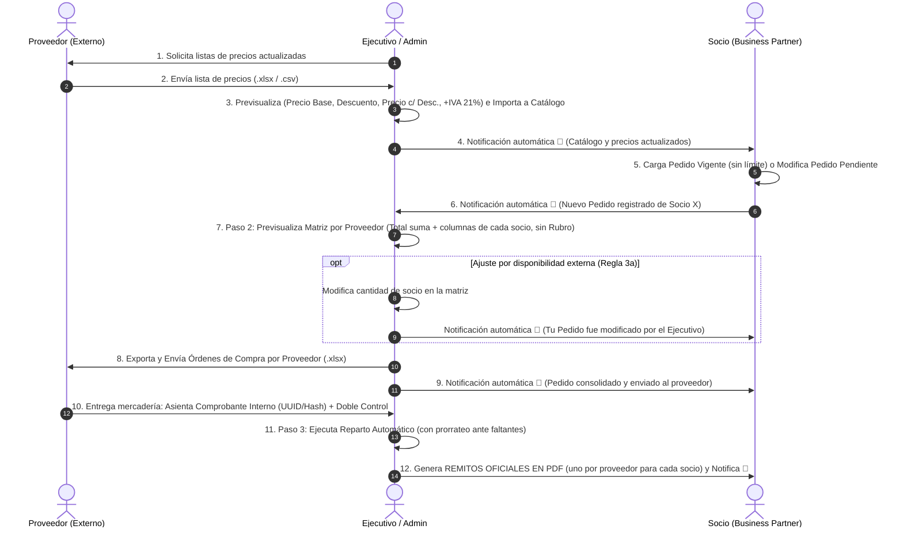

# Rosario Compras - Walkthrough del Circuito Operativo Refinado

Documento explicativo del flujo integral de abastecimiento, compras agrupadas, consolidación matricial por proveedor, comprobantes internos con doble control, reparto automático y emisión de remitos en PDF oficiales.

---

## 1. Diagrama de Secuencia

---

## 2. Descripción de los Pasos Operativos

### Paso 1: Solicitud de Listas de Precios
El Ejecutivo de Cuentas inicia el ciclo solicitando formalmente las listas de precios actualizadas a los proveedores asignados desde el módulo **"1. Listas y Proveedores"**.

### Paso 2 y 3: Recepción, Previsualización Impositiva e Importación
El proveedor envía su planilla (.xlsx o .csv). El sistema la analiza calculando cuatro columnas clave: **Precio Base**, **Descuento (%)**, **Precio con Descuento** y **Precio + IVA (21%)**, incorporando los artículos a `ARTICULOS` y `PRECIOS_NEGOCIADOS`.

### Paso 4: Aviso Masivo de Catálogo Disponible
🔔 El sistema emite automáticamente una notificación a todos los Socios:
*"El Ejecutivo actualizó el catálogo con productos del proveedor. Ya puedes consultar precios y cargar tu pedido."*

### Paso 5: Carga, Modificación e Historial del Socio
El socio puede pedir la cantidad que desee (sin límites artificiales).
- **Pedido Vigente:** Si tiene un pedido sin cerrar (`Pendiente`), el sistema lo carga para poder modificar cantidades y guardar cambios.
- **Historial de Pedidos:** Registro completo de pedidos pasados con códigos comerciales protegidos (`RC-ORD-XXXXXX`), estados y detalles.

### Paso 6: Notificación Automática de Pedido
🔔 Al confirmar o modificar el pedido, el sistema dispara automáticamente una notificación al panel del ejecutivo de cuentas avisando del pedido registrado.

### Paso 7: Paso 2 - Previsualización Matricial por Proveedor
El ejecutivo selecciona el proveedor y accede a una grilla matricial con:
- `Código`, `Artículo / Producto`, `Precio Unitario`, **`Total Cantidad (Suma de todos los socios)`**, y columnas individuales por socio (sin columna `Rubro`).

### Regla 3a: Ajustes Ejecutivos por Disponibilidad Externa
Si el proveedor comunica limitaciones externas, el Ejecutivo ajusta cantidades en la grilla. Al guardar, 🔔 el socio recibe una notificación automática avisándole que su pedido fue modificado por el ejecutivo con el desglose del cambio.

### Paso 8 y 9: Envío a Proveedores y Notificación al Socio
El ejecutivo exporta las Órdenes de Compra por Proveedor (`.xlsx`) y confirma el despacho. Los pedidos pasan a `Consolidado` y 🔔 cada socio es notificado.

### Paso 10: Paso 3 - Recepción por Comprobante Interno Automático
Muestra pedidos consolidados con filtro de proveedor y pedido consolidado (para gestionar entregas simultáneas). El sistema autogenera un **Nro. de Comprobante Interno con UUID/Hash** (sin tipeo manual) y asienta el doble control compras/logística para actualizar el stock real.

### Paso 11 y 12: Reparto Automático y Emisión de Remitos PDF Oficiales
Se ejecuta el reparto (con prorrateo equitativo si hubo quiebre de stock) y se generan automáticamente los **Remitos oficiales en formato PDF** (uno por cada proveedor para cada socio involucrado), almacenados en `remitos_pdf/`. 🔔 Se notifica a cada socio con su remito listo para entrega.

---

## 3. Credenciales de Acceso para Pruebas

| Rol | Nombre | Email | Contraseña | Permisos |
| :--- | :--- | :--- | :--- | :--- |
| **`ejecutivo`** | Ejecutivo de Cuentas | `ejecutivo@rosariocompras.com` | `account123` | Acceso a los 3 módulos del circuito completo, ajuste matricial y remitos PDF. |
| **`admin`** | Administrador General | `admin@rosariocompras.com` | `admin123` | Acceso total y auditoría. |
| **`socio`** | Café Central (Socio 1) | `socio1@rosariocompras.com` | `socio123` | Pedido vigente, modificación, historial y consulta de remitos. |
| **`socio`** | Panadería La Rosa (Socio 2) | `socio2@rosariocompras.com` | `socio123` | Pedido vigente, modificación, historial y consulta de remitos. |
