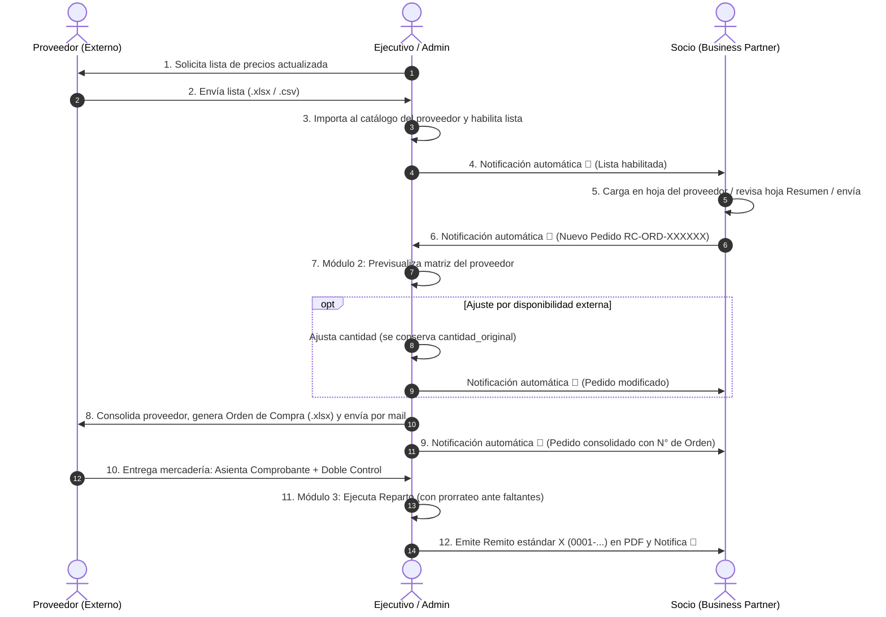

# Rosario Compras - Walkthrough del Circuito Operativo

Documento explicativo del flujo vigente de abastecimiento por proveedor: habilitación de listas, carga en hojas estilo Excel con hoja Resumen, consolidación con Orden de Compra en Excel, doble control de recepción, reparto con Remito estándar (Letra X) y consulta de historiales.

---

## 1. Diagrama de Secuencia

---

## 2. Descripción de los Pasos Operativos

1. **Listas por Proveedor (Módulo 1):** Cada artículo pertenece al catálogo de un único proveedor. Al importar una lista nueva, se habilita automáticamente el ciclo de pedidos y se notifica a los socios.
2. **Carga de Pedidos (Portal del Socio):** Cada lista habilitada se muestra como una hoja estilo Excel, precedida por la hoja de solo lectura **`🧾 Resumen`**. Cada hoja genera un pedido independiente (`PEDIDOS.id_proveedor`) con precio congelado (`DETALLE_PEDIDOS.precio_unitario`).
3. **Historial y Datos Fiscales del Socio:** El socio consulta sus pedidos con filtros por proveedor, estado y fechas, ve la trazabilidad de cantidades ajustadas por el ejecutivo, descarga su **Nota de Pedido en PDF**, accede al remito y actualiza sus datos en **Mis Datos Fiscales**.
4. **Consolidación y Orden de Compra (Módulo 2):** El ejecutivo ajusta la matriz si hay restricciones del proveedor (conservando `cantidad_original` incluso si baja a `0`) y consolida por proveedor. El sistema genera la **Orden de Compra en Excel (`RC-OC-XXXXXX`)**, la registra en `ORDENES_COMPRA` y cierra la lista.
5. **Recepción y Reparto (Módulo 3):** Se selecciona proveedor obligatorio y pedido consolidado, se asienta el comprobante con doble control (cantidades y precios) y se emiten los **Remitos estándar Letra X (`0001-00000001`)** en `remitos_pdf/` (ORIGINAL y DUPLICADO).
6. **Historial del Ejecutivo:** Permite consultar y reabrir/reenviar **Órdenes de Compra**, regenerar/abrir **Remitos Emitidos** y auditar **Comprobantes de Proveedores** con filtro por fechas.

---

## 3. Credenciales de Acceso para Pruebas

| Rol | Nombre | Email | Contraseña |
| :--- | :--- | :--- | :--- |
| **`ejecutivo`** | Ejecutivo de Cuentas | `ejecutivo@rosariocompras.com` | `account123` |
| **`admin`** | Administrador General | `admin@rosariocompras.com` | `admin123` |
| **`socio`** | Café Central (Socio 1) | `socio1@rosariocompras.com` | `socio123` |
| **`socio`** | Panadería La Rosa (Socio 2) | `socio2@rosariocompras.com` | `socio123` |
| **`socio`** | Restaurante Italia (Socio 3) | `socio3@rosariocompras.com` | `socio123` |
