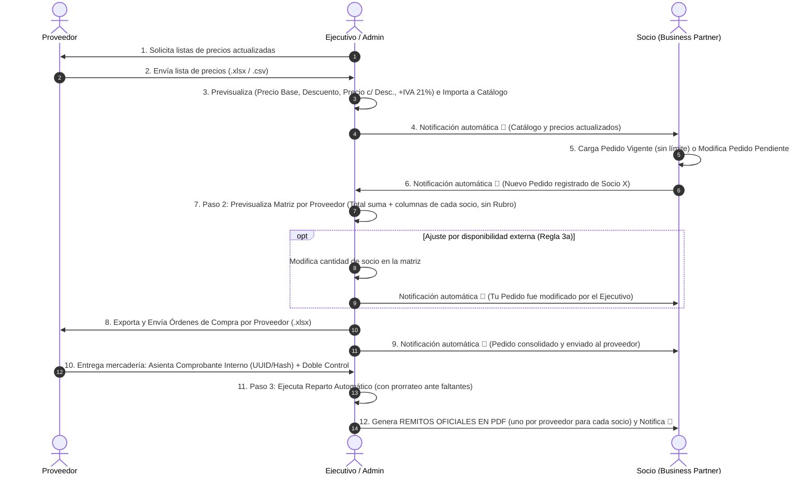

# 🔄 Circuito Operativo Refinado: 3 Pasos Principales y Reglas de Negocio

Este documento detalla el funcionamiento del sistema tras la consolidación de módulos, la incorporación de las reglas comerciales y la generación de remitos oficiales en PDF.

---

## 📊 Diagrama de Secuencia del Circuito Operativo

---

## 🛠️ Detalle de Módulos y Reglas Implementadas

### Módulo 1: Listas y Proveedores (Paso 1)
- Solicitud formal de cotizaciones por correo electrónico con membrete institucional.
- **Grilla de Previsualización Impositiva:**
  - `Precio Base`: Precio de lista original del proveedor.
  - `Descuento (%)`: Bonificación acordada.
  - `Precio c/ Descuento`: Precio neto de adquisición.
  - `Precio + IVA (21%)`: Importe final con alícuota impositiva.
- Importación masiva a `ARTICULOS` y `PRECIOS_NEGOCIADOS` con aviso automático a todos los socios.

### Portal del Socio: Gestión de Pedidos (Vigente e Historial)
- **Pedido Vigente (Estado 'Pendiente'):**
  - Si el socio ya cargó un pedido y aún no fue consolidado, el sistema lo despliega en modo edición.
  - Permite modificar cantidades, sumar productos y pulsar *"💾 Guardar Modificaciones del Pedido"*.
- **Historial de Pedidos:**
  - Consulta interactiva con Nro. de Pedido ofuscado (`RC-ORD-XXXXXX`), fecha, estado operativo (`Pendiente`, `Consolidado`, `Procesado`), volumen de unidades y total estimado.

### Módulo 2: Previsualización y Consolidado (Paso 2)
*(Combina y unifica la carga y la consolidación para Ejecutivos y Administradores)*
- **Selección por Proveedor:** El operador elige el proveedor a gestionar en un dropdown central.
- **Grilla Matricial por Socio:**
  - Columnas: `Código`, `Artículo / Producto`, `Precio Unitario`, **`Total Cantidad (Suma general)`**, y una columna individual por cada socio con pedido pendiente.
  - **Columna `Rubro` removida** para máxima compacidad y claridad visual.
- **Regla de Negocio 3a (Modificación Ejecutiva):**
  - El Ejecutivo puede editar las cantidades de cualquier socio en la grilla.
  - La columna `Total Cantidad (Suma)` se recalcula en tiempo real.
  - Al presionar *"💾 Guardar Modificaciones"*, se actualiza la base de datos y se dispara una notificación al socio:
    `"⚠️ Tu Pedido RC-ORD-XXXXXX fue modificado por el Ejecutivo: [Artículo]: Xu ➔ Yu."`
- **Regla de Negocio 3b (Libertad de Cantidad):**
  - Los socios cargan la cantidad que deseen; el Ejecutivo realiza los ajustes según el stock físico comunicado externamente por el proveedor.
- **Despacho y Envío:** Exportación de órdenes independientes por proveedor y consolidación hacia el Paso 3.

### Módulo 3: Recepción y Reparto Automático (Paso 3)
- **Privacidad Comercial con UUIDs / Hashes:**
  - Todos los pedidos y comprobantes utilizan identificadores no correlativos (`RC-ORD-XXXXXX`, `RC-REM-XXXXXX`, `CMP-REC-XXXXXX`) impidiendo inferir el volumen comercial de la empresa.
- **Selección Multinivel:**
  - Dropdown de Proveedor.
  - Dropdown de **Nro. de Pedido Consolidado** (permite seleccionar pedidos específicos cuando hay entregas simultáneas o desfasadas de un mismo proveedor).
- **Nro. de Comprobante Interno Automático:**
  - Se genera de forma interna y automática (`CMP-REC-XXXXXX`) con opción de generar nuevo ID mediante un clic, eliminando el tipeo manual.
- **Doble Control y Auditoría:** Validación de precios facturados (Compras) y unidades recibidas (Logística) con detección de discrepancias y prorrateo equitativo automático.
- **Generación de Remitos Oficiales en Formato PDF:**
  - Emite **un PDF oficial por cada proveedor para cada socio involucrado**.
  - Documentos profesionales con membrete, tabla de entrega, firmas y almacenamiento en la carpeta `remitos_pdf/`.
  - Notificación automática con aviso del remito PDF listo para entrega.
